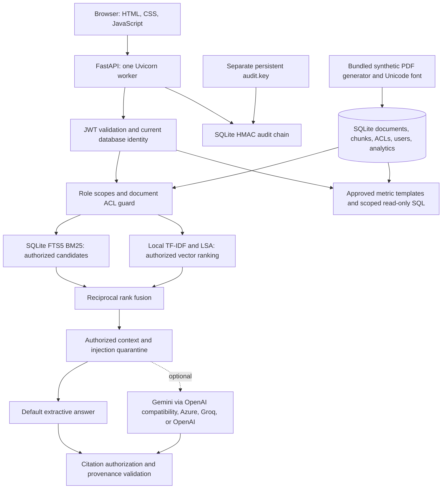

# OrgMind · Enterprise Knowledge Workspace

A synthetic ACME Technologies knowledge and document-intelligence application with credential accounts, role-scoped retrieval, cited answers, and constrained SQL analytics. FastAPI serves the API and a responsive, dependency-free browser interface at one URL. Deterministic fallback requires no external API keys.

> **Authentication and data:** the supplied `.env.example`, Docker image, and Render Blueprint disable passwordless personas. Set `ALLOW_DEMO_PERSONA=false` explicitly in existing environments too: development without configuration retains the legacy demo API for compatibility. `ALLOW_DEMO_PERSONA=true` gives any API caller access to every seeded persona, including administrator; it is unsuitable for private data. Use only synthetic documents in public demonstrations. Never publish production passwords or provider keys.

## Problem and scope

Enterprise search must not pass restricted documents to an answer generator just because they match a question. OrgMind enforces current database permissions before candidate ranking, context construction, citation inspection, and analytics. It demonstrates these controls rather than claiming production certification or mathematically leak-proof retrieval.

The public landing offers credential sign-in and a synthetic-demo introduction. Employees use Knowledge Workspace, Documents, and My account. Administrators additionally manage users, departments, document permissions, organizational analytics, provider status, and audit activity. Live Role Comparator and Live Benchmark are separated into administrative diagnostics. Every administrative API enforces backend authorization, not merely hidden UI controls.

## Architecture



**Stack:** Python **3.12.3** (tested development runtime and container base), FastAPI/Uvicorn, SQLite/FTS5, PyMuPDF, scikit-learn/NumPy, PyJWT, pwdlib/Argon2, HTTPX, pytest, and vanilla HTML/CSS/JavaScript. Dependency versions are maintained in `requirements.txt`. PyMuPDF 1.28.2 is intentionally pinned as the lightweight release, avoiding the ONNX/layout dependencies introduced by the removed 2.1 release.

### Project structure

```text
app/
  main.py                API, lifecycle, static frontend, authorization boundary
  config.py              Environment settings
  auth.py                Password login, demo personas, JWT validation
  manage.py              Local password provisioning
  accounts.py            Administrator accounts, departments, overview
  workspace.py           Owned PDF library, previews, session conversations
  product_generation.py  Conversational generation using current evidence
  database.py            Idempotent migrations/seeds, ACL epoch, audit chain
  pdf_corpus.py          Nine reproducible synthetic PDFs
  assets/fonts/          DejaVuSans.ttf and LICENSE.dejavu.txt
  rag_engine.py          PDF extraction, chunks, BM25, LSA, RRF
  rbac_guard.py          Roles, scopes, citation authorization
  sql_analytics.py       Allowlisted, read-only analytics
  llm_service.py         Local generation and optional provider adapters
  http_limits.py         Multipart request-body limit
  evaluator.py           Fixed retrieval benchmark and memory sampling
static/                  index.html, styles.css, app.js
tests/                   Automated regression and boundary tests
data/corpus/             Generated synthetic PDFs (runtime)
data/runtime/            orgmind.sqlite3 and audit.key (runtime)
scripts/diagnose_gemini.py Hidden-input, real-provider diagnostic utility
.env.example             Local configuration template
requirements.txt         Dependencies
Dockerfile               Single-process, non-root container
.dockerignore            Excludes local state and secrets from build context
render.yaml              Free, ephemeral-storage public-demo blueprint
```

## Local installation and startup

Use Python 3.12.3 with SQLite FTS5 support. From the repository root:

```bash
python3.12 -m venv .venv
.venv/bin/python -m pip install -r requirements.txt
cp .env.example .env
.venv/bin/python -m uvicorn app.main:app --reload
```

Open **http://127.0.0.1:8000**. Interactive API documentation is at `/docs`; readiness is `/api/health`. The development environment was installed and verified with Python 3.12.3. The explicit `.venv/bin/python` commands do not require activating the environment; alternatively run `source .venv/bin/activate`.

Startup migrates both fresh and existing SQLite schemas idempotently, preserving existing users, ACLs, documents, and audit records. It generates/checks the nine synthetic PDFs, seeds documents once per database, indexes missing seeded chunks, and rebuilds the in-memory retrieval index. Workspace recovery reconciles interrupted ingestion and stored originals. Fresh/existing database migration and recovery behavior is covered by automated tests. The bundled DejaVu font supports the `₹` glyph; **no system font installation is required**. Its redistribution notice is `app/assets/fonts/LICENSE.dejavu.txt`.

### Personas and authentication

| Persona ID / username | Role | Authorized scopes |
| --- | --- | --- |
| `admin_user` | `admin` | general, hr, finance, engineering, executive |
| `finance_user` | `finance` | general, finance |
| `hr_user` | `hr` | general, hr |
| `eng_user` | `engineering` | general, engineering |
| `general_user` | `employee` | general |
| `executive_user` | `executive` | general, executive |

Executive is **not** a superuser. Shared documents require an intersection between allowed scopes and current role scopes. Private workspace uploads are owner-only, with administrator management access; ownership is checked by the backend, including legacy retrieval paths. The persona table describes initial roles; an administrator can change them.

Seeded passwords are random Argon2 hashes: **there is no fixed demo password**. Normal browser sign-in uses username/email and password. The legacy `POST /api/auth/demo-persona` endpoint remains available only when `ALLOW_DEMO_PERSONA=true`, for regression and diagnostic compatibility; it must stay disabled in the deployed product.

Administrators create individual accounts and departments through the administration interface. Account names, email, department, role, activation, and password changes are stored in SQLite; department labels alone grant no document scopes. Deactivation and identity changes invalidate previous tokens. The last active administrator cannot be demoted or deactivated through account APIs.

For explicitly configured synthetic demonstration accounts, privately set both `DEMO_ADMIN_USERNAME` / `DEMO_ADMIN_PASSWORD` and/or `DEMO_EMPLOYEE_USERNAME` / `DEMO_EMPLOYEE_PASSWORD`. Passwords must contain 12–256 characters; startup stores Argon2 hashes and provisions each configured account once, rather than resetting edits on restart. Use different usernames. Existing unrelated accounts are not silently replaced. Share demonstration credentials only through an appropriate private channel; Explore Demo does not bypass login. Remove provisioning secrets when they are no longer needed on persistent installations; on ephemeral Render instances they are needed again after data resets.

For private mode, stop the server, set `ALLOW_DEMO_PERSONA=false`, set a stable random `JWT_SECRET` of at least 32 characters, and provision a password locally against the same `DATA_DIR`:

```bash
.venv/bin/python -m app.manage set-password admin_user
```

The command uses hidden interactive prompts, requires at least 12 characters, and invalidates prior tokens for that persona. Repeat for other required personas, then start the server and use password login. Private mode removes public persona access; it does not by itself provide all controls needed for a production service. Do not bake passwords or a provisioned database into the image.

JWTs use HS256, a 60-minute lifetime, issuer/audience checks, and required identity/version claims. Every protected operation reloads the user's role and `auth_version` from SQLite. Password or role changes invalidate old tokens. Development can use an ephemeral signing key, invalidating tokens at restart; production refuses a missing/short key.

## Retrieval, RBAC, and citations

1. Verify the bearer token and current database identity.
2. Resolve authorized chunk IDs from role scopes and document ACLs.
3. Apply authorization **before** BM25 ranking/limits and LSA vector similarity ranking.
4. Merge authorized candidates, quarantine suspicious context, and generate an answer.
5. Validate cited chunk authorization and document/page/title provenance; reauthorize citation inspection separately.

**BM25** uses SQLite FTS5 lexical matching. Query terms are OR-combined, so broad matches can include irrelevant but authorized evidence. **LSA** uses local TF-IDF unigram/bigram features with deterministic truncated SVD (up to 64 dimensions), normalized vectors, and cosine similarity; tiny indexes fall back to normalized TF-IDF. This is corpus-trained latent semantic retrieval, not a pretrained neural embedding model. **RRF** combines the two rankings with reciprocal scores $1/(60+r)$ for rank $r$, returning five chunks by default. Both rankings consider up to 30 candidates.

Legacy chat and the fixed benchmark retain the original local sentence extractor. The product workspace has a separate conversational path: selected-document retrieval, bounded session history, focused local fallback, and optional provider synthesis using current authorized evidence. Revoked historical assistant content is not reused as evidence. With no usable evidence, the denial text is:

> Insufficient authorized evidence in your permitted workspace scopes to answer this request.

Document upload, ACL edits, deletion, and user changes advance a global **ACL epoch**. Lifecycle writes rebuild the index; a stale epoch triggers rebuilding on retrieval. Ordinary requests do not repeatedly re-index unchanged data. There is **no answer cache**. A process-local lock serializes protected operations and lifecycle changes; this is why deployment uses exactly one worker, not multiple independent processes.

### Corpus

Nine synthetic PDFs cover the employee handbook, HR leave/compensation, finance budget, executive bonus/acquisition planning, engineering architecture, infrastructure runbook, procurement/vendor policy, general IT acceptable use, and a deliberately poisoned vendor brochure for injection tests. The handbook includes the **₹18/km** reimbursement example. Finance and executive personas can both see the bonus/acquisition document; HR, engineering, and employee personas cannot. The ordinary product library/chat excludes the poisoned `DOC_09` fixture; the unchanged legacy benchmark still exercises it.

### Owned PDFs and session history

Employees can upload private PDFs through the product workspace. Administrators can manage documents and assign shared scopes. Original PDFs are stored on the configured local data filesystem alongside indexed text; authorized users can download them, render individual pages, and inspect cited excerpts. Owners and administrators can reindex or delete uploads. Deletion invalidates indexed content and subsequent preview, excerpt, and selected-document chat access. The original administrator-only upload API remains supported.

Ingestion exposes `uploaded`, `processing`, `indexed`, and `failed` states. Existing seeded `ready` records are exposed as `indexed` by the product API without rewriting legacy storage. Restart recovery reconciles interrupted ingestion and missing originals. Uploads require a PDF signature and extractable text; the legacy upload also requires `application/pdf` and nonempty allowed scopes. Defaults limit PDF bytes to 5 MiB, pages to 100, and extracted text to 1,000,000 characters. Encrypted PDFs and image-only PDFs without extractable text are rejected; OCR is not provided. `app/http_limits.py` also caps multipart request overhead, including streamed bodies. This is not a hardened general-purpose PDF sandbox.

Conversation history is bounded and held in process memory, scoped to the authenticated login session. Reloading with the same token can restore history; logout/new login or a server restart does not provide durable cross-session history. New chat starts a separate conversation. ACL changes invalidate stale conversation context, and document access is rechecked for chat, citations, and previews. Private data must not be placed on an ephemeral public demo instance.

### SQL analytics

The API accepts a **metric ID**, never arbitrary SQL or model-generated SQL. Bound parameters supply the metric, optional period, and server-derived scope filter. A SQLite `mode=ro` connection, restrictive authorizer, 100,000 VM-step budget, and 50-row limit constrain execution. Results are checked against authorized scopes before return.

| Metric ID | Permitted roles |
| --- | --- |
| `department_headcount` | All roles; only their scoped rows |
| `quarterly_budget_summary` | admin, finance |
| `sla_uptime_metrics` | admin, engineering |
| `compensation_band_summary` | admin, hr |
| `vendor_spend_rollup` | admin, finance, hr; scoped rows |

Example request: `{"metric_id":"department_headcount","period":"2026-Q4"}` to `POST /api/sql/query`.

### Audit and prompt-injection limitations

Audit entries record identity, action, decision, policy rule/intercept, blocked document IDs where applicable, ACL epoch, and chained HMAC-SHA256 values. A separate persistent `data/runtime/audit.key` protects verification independently of JWT rotation. Preserve this key with the database and restrict filesystem access. The chain detects covered-entry edits without the key; it is **not externally anchored**, does not detect tail truncation, and cannot protect against an OS administrator or complete log-and-key compromise.

Suspicious instruction patterns in retrieved fields are quarantined before both generation paths. The question and authorized context are serialized as data in a separate user message; no tools are exposed to providers. Detection is a heuristic with false positives and false negatives, not a comprehensive injection defense. Authorization is enforced outside the model. Valid citations show authorized provenance, **not proof of every answer's factual correctness**. Shared corpus statistics, model hallucination, availability attacks, and broader side channels are not claimed eliminated.

## API reference

Protected routes require `Authorization: Bearer <token>`. Request models reject unexpected fields.

| Method and path | Access / request |
| --- | --- |
| `GET /api/health` | Public readiness and synthetic-data flag |
| `GET /api/config` | Public demo configuration and available personas |
| `POST /api/auth/login` | Public; `username` (username or email), `password` |
| `POST /api/auth/demo-persona` | Public only when enabled; `persona_id` |
| `GET /api/auth/me` | Authenticated current identity |
| `POST /api/chat` | Authenticated; `query` |
| `POST /api/chat/compare-roles` | Admin; `query`; evaluates five non-admin personas |
| `POST /api/sql/query` | Authenticated; `metric_id`, optional `period` |
| `GET /api/documents` | Authenticated, scoped document listing |
| `GET /api/documents/{doc_id}/chunks/{chunk_id}` | Authenticated, reauthorized evidence inspection |
| `POST /api/documents/upload` | Admin; multipart `file` and JSON-string `allowed_scopes` |
| `PATCH /api/documents/{doc_id}/permissions` | Admin; `allowed_scopes` array |
| `DELETE /api/documents/{doc_id}` | Admin |
| `PATCH /api/admin/users/{uid}/role` | Admin; `role` |
| `GET /api/admin/audit-logs?limit=50` | Admin; limit 1–100, chain-verification result |
| `GET /api/eval/benchmark` | Admin; evaluates current corpus without rewriting labels |

### Product account and workspace APIs

| Method and path | Access / behavior |
| --- | --- |
| `GET /api/admin/overview` | Admin; live organization counts |
| `GET, POST /api/admin/users` | Admin; list/create individual accounts |
| `GET, PATCH /api/admin/users/{uid}` | Admin; inspect/update account identity, role, department, activation |
| `POST /api/admin/users/{uid}/password` | Admin; reset password and invalidate tokens |
| `POST /api/admin/users/{uid}/activate`, `/deactivate` | Admin; explicit account activation/deactivation |
| `GET /api/admin/roles` | Admin; available roles |
| `GET, POST /api/admin/departments` | Admin; list/create departments |
| `GET, PATCH, DELETE /api/admin/departments/{department_id}` | Admin; department management |
| `GET /api/admin/provider-status` | Admin; sanitized last-call status and audit-based counts, not a live provider probe |
| `GET /api/workspace/documents` | Authenticated; owned/authorized library, search and status filters |
| `POST /api/workspace/documents/upload` | Authenticated; private PDF upload with recorded ownership |
| `GET /api/workspace/documents/{doc_id}/preview` | Authorized document; PDF page image |
| `GET /api/workspace/documents/{doc_id}/download` | Authorized document; original PDF |
| `POST /api/workspace/documents/{doc_id}/reindex` | Owner or admin; reindex original PDF |
| `DELETE /api/workspace/documents/{doc_id}` | Owner or admin; remove original and indexed data |
| `PATCH /api/workspace/documents/{doc_id}/permissions` | Admin; change visibility/scopes |
| `POST /api/workspace/chat` | Authenticated; current evidence, optional selected documents and conversation |
| `GET /api/workspace/conversations` | Authenticated; current login-session history |
| `GET, DELETE /api/workspace/conversations/{conversation_id}` | Authenticated; inspect/delete own session conversation |

## Configuration and optional providers

Settings load `.env` for local development. Do not commit secrets; the Docker build excludes `.env`. Provider selection is opt-in, and provider use transmits questions and authorized context to the configured external service. Obtain appropriate permission before enabling it.

| Variable | Default / purpose |
| --- | --- |
| `APP_ENV` | `development`; `production` requires a strong configured JWT secret |
| `JWT_SECRET` | Ephemeral in development if absent/short; production requires ≥32 random characters |
| `ALLOW_DEMO_PERSONA` | Legacy API: `true` in unconfigured development; supplied environment template and Render set `false` |
| `DATA_DIR` | `data`; writable database, audit-key, and corpus location |
| `MAX_UPLOAD_BYTES` | `5242880` |
| `CHUNK_SIZE`, `CHUNK_OVERLAP` | `900`, `150` characters |
| `GENERATION_PROVIDER` | `local`; alternatives `azure`, `groq`, `openai` |
| `GENERATION_TIMEOUT_SECONDS` | `15` |
| `AZURE_OPENAI_ENDPOINT`, `AZURE_OPENAI_API_KEY` | Required for Azure calls |
| `AZURE_OPENAI_DEPLOYMENT` | Azure generation deployment name |
| `AZURE_OPENAI_API_VERSION` | `2024-10-21` |
| `GROQ_API_KEY` | Required for Groq generation |
| `GROQ_BASE_URL`, `GROQ_MODEL` | `https://api.groq.com/openai/v1`, `llama-3.3-70b-versatile` |
| `OPENAI_API_KEY` | Required for OpenAI calls |
| `OPENAI_BASE_URL`, `OPENAI_MODEL` | `https://api.openai.com/v1`, `gpt-4o-mini` |
| `EMBEDDING_PROVIDER` | `local`; standalone adapter supports `azure` or `openai` |
| `AZURE_OPENAI_EMBEDDING_DEPLOYMENT` | Azure embedding deployment name |
| `OPENAI_EMBEDDING_MODEL` | `text-embedding-3-small` |
| `EMBEDDING_TIMEOUT_SECONDS` | `15` |
| `PORT` | Container listener port; defaults to `8000`, Render supplies it |

For Azure generation, set `GENERATION_PROVIDER=azure` and the endpoint, key, and generation deployment above. For Groq, set `GENERATION_PROVIDER=groq` and `GROQ_API_KEY`; model/base overrides are optional. For OpenAI, set `GENERATION_PROVIDER=openai` and `OPENAI_API_KEY`. Restart after changing generation selection. Missing configuration, transport errors, or invalid provider responses fall back to local extraction without exposing provider error bodies or secrets.

### Gate B: Gemini diagnostics and manual verification

Use `GENERATION_PROVIDER=openai`, `OPENAI_BASE_URL=https://generativelanguage.googleapis.com/v1beta/openai/`, and `OPENAI_MODEL=gemini-3.8-flash`. This is the documented stable model, not a presumed nonexistent identifier. Application credentials still use the existing `OPENAI_API_KEY` configuration. Gemini generation omits `temperature`; generic OpenAI/Groq/Azure payloads and embeddings retain their existing behavior.

**Integration interface:** after `service.generate(query, chunks)`, read `service.last_diagnostics`. The legacy return dictionary is unchanged. Diagnostics are a separate, replaced-per-call dictionary with exactly:

| Field | Meaning |
| --- | --- |
| `provider` | `gemini` for Google's OpenAI-compatible endpoint; otherwise a bounded provider label (`openai`, `azure`, `groq`, `local`, `spy`, `custom`) |
| `model` | Configured model/deployment identifier, or `None` if unavailable/unsafe to display |
| `http_status` | Exact final-attempt HTTP code, including malformed HTTP 200 responses; `None` when no response arrived |
| `error_category` | `auth` (401), `permission` (403), `quota` (429), `model` (404), `timeout` (408/504 or transport timeout), `service` (other 5xx/network errors), `config` (configuration/other HTTP rejection), `malformed` (invalid completion), or `None` |
| `succeeded` | A valid adapter response was obtained, **not** proof of factual correctness or a successful application answer |
| `fallback_used` | The service retained local extraction/denial rather than accepting external output |

Local-only generation and a non-delegating spy have `succeeded=False`, `fallback_used=True`, and no error. A valid external response with no supporting context can have both booleans true: the response was obtained but ignored. String-returning mocks still work. `HTTPGenerationAdapter.last_diagnostics` is also available; its failure flag requests fallback, while `LLMService` reports the actual outcome. `SpyLLMRecorder.last_diagnostics` proxies a copy of HTTP/delegating-spy diagnostics without changing recorded messages. These mutable, process-local last-call snapshots are not request-scoped, durable history, or concurrency-safe correlation; copy the service dictionary immediately after the call when integrating. No raw provider body, exception, URL, or credential is included.

Gemini requests retry **only 429 and 503**, with at most three total attempts and waits of 0.25 and 0.5 seconds. No 403 retry, redirects, or unbounded `Retry-After` delays occur. Generic generation and embeddings are not given these retries. `GENERATION_TIMEOUT_SECONDS` remains 15 by default, applied per attempt; it is not a total wall-clock deadline. Status/category describe the final attempt, not its retry history.

**Manual remote check (requires an authorized key and an interactive terminal):**

1. From the project directory in the intended runtime/network environment, run:
   ```bash
   .venv/bin/python -m scripts.diagnose_gemini
   ```
2. Enter the key only at the hidden `getpass` prompt. The utility accepts **no arguments** (including key flags), reads no environment key or `.env`, never falls back to echoing input, and does not save the key. Do not put a key in shell commands, logs, screenshots, or source. The key necessarily exists in process memory during the check; memory erasure is not guaranteed.
3. It first sends an authenticated **GET** to `/v1beta/models/gemini-3.8-flash`, using a header rather than a query-string key. Only a valid model response permits a small completion request to `/v1beta/openai/chat/completions` (`max_tokens=128`, no temperature). Each step prints only stage and safe diagnostic fields, including the exact HTTP code; completion text and provider error bodies are never printed. Both steps use bounded retries and 15-second per-attempt timeouts. Exit codes: `0` both checks passed, `1` provider/response failure, `2` invalid input or cancellation. The CLI never performs extractive fallback.
4. An access check alone does not prove completion access. On failure, use only the safe status to guide authorized account/project checks: credentials for 401, permissions/restrictions for 403, quota/billing for 429, model access **or endpoint configuration** for 404, and availability/timeouts for 5xx or transport failures. Categories are coarse HTTP classifications, not definitive root causes; error text is intentionally not inspected or exposed. Re-run from the deployment environment if a local check passes, and configure application secrets through the deployment's secret manager rather than this utility.

The actual remote Gemini failure remains **unknown**. No real key was available for Gate B verification; no real provider success or deployment fix is claimed. `BASELINE-REPORT.md` retains the pre-implementation audit. Official references: [OpenAI compatibility](https://aistudio.google.com/docs/openai), [stable model](https://aistudio.google.com/docs/models/gemini-3.8-flash), [troubleshooting](https://aistudio.google.com/docs/troubleshooting).

**Embedding scope:** `EmbeddingService` is a separately configured adapter and **extension point only, not wired into `RagEngine`**. Setting embedding variables does not replace or augment live retrieval: the application still uses offline LSA. Explicit adapter callers receive `None` for local mode and a sanitized error on external failure. `.env.example` documents the exact adapter names, including `AZURE_OPENAI_EMBEDDING_DEPLOYMENT` and `OPENAI_EMBEDDING_MODEL`, provider timeouts, and Groq defaults. External adapters have mocked tests; no real Azure/Groq/OpenAI calls or credentials were needed for local verification.

## Tests and measured results

```bash
.venv/bin/python -m pytest -v
```

**Final productization full-suite result:** `.venv/bin/python -m pytest -v` completed with **417 passed, 0 warnings in 101.70 seconds**. The ten original test/conftest files from the 285-test baseline have unchanged SHA-256 hashes: no existing test was removed or weakened. Productization adds 132 passing cases. Existing candidate-precision assertions remain under the accurately named `evidence_precision` metric. Starlette TestClient uses pinned `httpx2`; provider integrations retain `httpx`. `tests/conftest.py` sets an explicit test-only JWT key before application imports, without changing deployment configuration or globally suppressing warnings. A regression test explicitly checks that a missing development key still emits its warning.

Coverage includes fresh/existing database migrations, accounts/departments and last-admin safeguards, identity/JWT invalidation, ownership and cross-role ACLs, PDF upload/reindex/deletion/recovery, session follow-ups and citations, provider outcomes/retries, constrained SQL, injection quarantine, unchanged benchmark scoring, and frontend contracts. External requests are mocked in ordinary tests; this is not real-provider verification.

### Browser and deployment verification

Playwright exercised the real backend on an isolated local instance, leaving the existing deployed service untouched:

- **Administrator:** credential login, live overview, department creation, employee creation/department assignment, PDF upload, private-to-shared permissions, analytics, provider status, and valid audit-chain inspection.
- **Employee:** login with the newly created account, role-separated navigation, own private PDF upload/library, selected-document question and follow-up, correct source/page citations, exact excerpt and rendered PDF preview, copy answer, new chat/history restoration, reindex, and deletion. After deletion, preview, excerpt, and selected-document chat each returned **404**.
- **Compatibility regression:** seeded documents display `indexed`, remain in the Indexed filter, and can be selected for a successful cited handbook answer. Legacy stored `ready` values are preserved.
- **Responsive:** desktop 1440×1000 and mobile 390×844 were reviewed; the measured mobile document width was 375px within the 390px viewport, without horizontal overflow.

- [x] Full automated suite: 417 passed, no warnings; original test hashes unchanged.
- [x] Local application startup and health; administrator/employee browser workflows.
- [x] Fixed 21-case live retrieval benchmark and actual live-process RSS measurement.
- [x] Packaging source checks, Docker command syntax checks, Render YAML parsing, and clean `git diff --check`.
- [ ] Docker image build/run: `docker build -t orgmind:local .` was attempted, but access to `/var/run/docker.sock` was denied. No image/container success is claimed.
- [ ] Real Gemini generation: no authorized key was available; safe diagnostics and mocked behavior are verified, but the remote failure's cause remains unknown.
- [ ] Render deployment: not performed; account access, provider checks, and deployment validation remain manual.

**Local product verification passed; deployment readiness is not fully verified while the Docker and real-provider checks remain blocked.**

### Final live-server benchmark

Observed final live application results for the unchanged initial corpus and fixed **21 cases** in `app/evaluator.py` (16 positive cases and five restricted-topic probes):

| Method | Recall@5 | MRR | Answer citation accuracy | Evidence precision | Unauthorized retrieval rate |
| --- | ---: | ---: | ---: | ---: | ---: |
| BM25 | 1.000000 | 1.000000 | 0.937500 | 0.3333333333 | 0 |
| LSA | 1.000000 | 0.968750 | 0.937500 | 0.4750000000 | 0 |
| Hybrid RRF | 1.000000 | 0.968750 | 0.937500 | 0.3333333333 | 0 |

Recall is macro-averaged distinct relevant-document recall in the first five chunks; MRR uses the first relevant chunk rank. **Citation accuracy now evaluates actual answer citations per positive answered query**: at least one citation must identify an authorized returned chunk with exact database provenance and a ground-truth document/page curated as containing the expected evidence. Each answered query counts once; an answer without citations fails. Denials and empty answers are excluded from this denominator and reported as unanswered. This is page-level citation support, not full generated-answer factual accuracy or sentence-level entailment. The benchmark always uses deterministic local extractive generation, regardless of external-provider environment settings.

All three methods answered **16/16** positive queries, with correct citations for **15/16**. The remaining suspicious-email reporting query cited the employee handbook (DOC_01, page 2), not its expected evidence page (DOC_08, page 2), and correctly scored as a failure. No benchmark cases or relevance labels were changed.

The old `citation_accuracy` calculation divided **19 relevant candidate chunks by 57 returned positive-case chunks** for BM25/Hybrid (19/40 for LSA). That measures **evidence precision**, not whether an answer has a supporting citation. It remains available as `evidence_precision`, with its original assertions retained. Unrelated but authorized retrieval candidates can lower this precision even when Recall@5 is 1.0.

Restricted-topic probes contribute to unauthorized retrieval rate, not recall/MRR/citation accuracy. An unrelated authorized result is not counted as an unauthorized retrieval. Zero observed unauthorized retrieval is a result for this finite suite, not a universal guarantee. The benchmark expects original source pages and persona permissions and fails explicitly when those prerequisites are missing or changed; it does not restore deleted documents or rewrite ground truth.

**Memory:** the final live, single-worker Uvicorn process measured **177.9609375 MiB current RSS** on local Linux, sampled from `/proc/self/statm`. This is a local snapshot, not test-runner memory and **not a guarantee of fitting within 512 MB** under every workload. Startup, uploads, concurrency, provider calls, and dependency/platform differences can change usage. The live benchmark reports its own current memory observation.

## Docker

The image uses `python:3.12.3-slim-bookworm`, bundled fonts, an unprivileged user, and a single Uvicorn process serving both frontend and API. Run from the repository root:

```bash
docker build -t orgmind:local .
```

Before running, configure `.env` with a strong `JWT_SECRET` (at least 32 random characters). A local generator is:

```bash
.venv/bin/python -c 'import secrets; print(secrets.token_urlsafe(48))'
```

Store the generated value privately in `.env`; never commit it. Configure the paired demonstration account variables privately, or provision passwords on the data volume. To run the credential-based application:

```bash
docker run --rm --name orgmind -p 8000:8000 --env-file .env \
  -e APP_ENV=production -e ALLOW_DEMO_PERSONA=false \
  -e DATA_DIR=/app/data orgmind:local
```

Open http://127.0.0.1:8000. Packaging source checks and Render YAML parsing passed locally; **image build/run remains unverified because access to the local Docker daemon was denied**. This command has ephemeral container storage. For optional local persistence, add `--mount type=volume,source=orgmind-data,target=/app/data` before the image name; preserve both SQLite and `audit.key`. For private mode, use `ALLOW_DEMO_PERSONA=false` and provision passwords with `python -m app.manage set-password admin_user` in a local container sharing that data volume, with the serving process stopped. Do not add extra Uvicorn workers.

## Render blueprint

`render.yaml` retains the **existing `orgmind-demo` free Docker service**, without a persistent disk. The Docker runtime pins Python 3.12.3, binds to `0.0.0.0:$PORT`, uses `/api/health`, sets `APP_ENV=production`, generates `JWT_SECRET` through `generateValue: true`, and now **sets `ALLOW_DEMO_PERSONA=false`**. Do not create a duplicate service.

1. In the existing Render service, privately provision paired demo-account variables or a persistent account provisioning strategy. Explicitly set `ALLOW_DEMO_PERSONA=false`; review existing dashboard overrides. Preserve the current signing secret unless intentionally revoking all sessions.
2. Keep the existing origin `https://github.com/dyson-25/orgmind-rbac-rag.git`. Review local tests, browser and Docker verification before committing or pushing. No push or deployment is performed automatically by this work.
3. After review, commit selected source/tests/docs (never `.env`, data, or keys), then push the existing tracked branch. Render redeploys after a push to its linked branch only if Auto-Deploy is enabled; otherwise use Deploy latest commit on the existing service. Blueprint environment changes may also require applying/syncing the Blueprint or editing that service's environment.
4. Check logs and `https://orgmind-demo.onrender.com/api/health`, then verify credential login, owned PDF upload/chat/citations and permissions. A public health response alone is not end-to-end verification.

**Configuration generation is not deployment.** Render account authorization, an actual build/deploy, external-provider credentials, and cloud memory/availability validation remain manual; no live Render deployment is claimed.

Free-service local storage is ephemeral. Redeployment or instance replacement can lose uploads, ACL/role/password changes, and audit history. Startup seeds are idempotent within the existing database: **an ordinary restart does not resurrect an administrator-deleted document**. Only losing/replacing the database permits initial corpus seeding again. In-memory indexes are rebuilt as needed from stored chunks and the reproducible corpus. SQLite on this filesystem is not durable cloud persistence. Private cloud use needs a durable storage/provisioning design, not merely turning off the demo flag on a disposable instance.

### Changed files and reviewed release commands

The explicit staging list below is the productization change inventory: account/ownership/provider backend changes, role-separated frontend, nine new test modules, configuration, this documentation, and the requested baseline audit. The earlier evaluator/warning polish is already part of the 285-test baseline and is not rewritten by productization.

**Not executed.** First obtain Docker daemon access and complete image/container checks, run the real Gemini diagnostic with an authorized key, and review the diff. Do not push while treating those blocked checks as passed. These commands stage only the listed intended files, not local credentials or runtime data:

```bash
git status --short
git diff --check
git add -- \
  .env.example README.md BASELINE-REPORT.md render.yaml \
  app/accounts.py app/auth.py app/config.py app/database.py \
  app/http_limits.py app/llm_service.py app/main.py app/manage.py \
  app/product_generation.py app/rag_engine.py app/rbac_guard.py app/workspace.py \
  scripts/diagnose_gemini.py \
  static/app.js static/index.html static/styles.css \
  tests/test_account_migrations.py tests/test_accounts.py \
  tests/test_diagnose_gemini.py tests/test_product_auth_integration.py \
  tests/test_product_frontend.py tests/test_provider_diagnostics.py \
  tests/test_provider_status_api.py tests/test_workspace.py \
  tests/test_workspace_boundaries.py
git diff --cached --check
git diff --cached --stat
git --no-pager diff --cached
```

Review **all** staged files, including any staged before these commands. Only after the review and remaining verification gates:

```bash
git commit -m "Productize OrgMind accounts, document workspace, and provider diagnostics" \
  -m "Co-authored-by: Copilot <223556219+Copilot@users.noreply.github.com>"
git push origin main
```

The existing origin and `main` branch are preserved. Pushing can trigger the existing Render service's linked-branch Auto-Deploy; otherwise deploy the latest commit manually as described above. No commit, push, duplicate service, or deployment has been created by this work.

## Limitations and future work

- Synthetic demonstration only; no production certification, API rate limiting, identity federation, or durable cloud storage is supplied.
- One process/worker is required by the synchronization model; scaling needs shared coordination and transactional cross-process authorization/index invalidation.
- Small-corpus LSA and lexical extraction have relevance limits; no OCR, neural embedding retrieval integration, or factuality proof is provided.
- Injection heuristics and unanchored local audit chains have the limitations described above.
- Public persona mode deliberately grants administrator access to everyone and permits destructive demo changes.
- Future work: managed durable database/object storage, durable cross-session conversations, externally anchored audit checkpoints, SSO and self-service account recovery, rate/resource controls, isolated PDF processing, stronger evaluation on larger independently labeled corpora, and explicitly tested external embedding integration.
