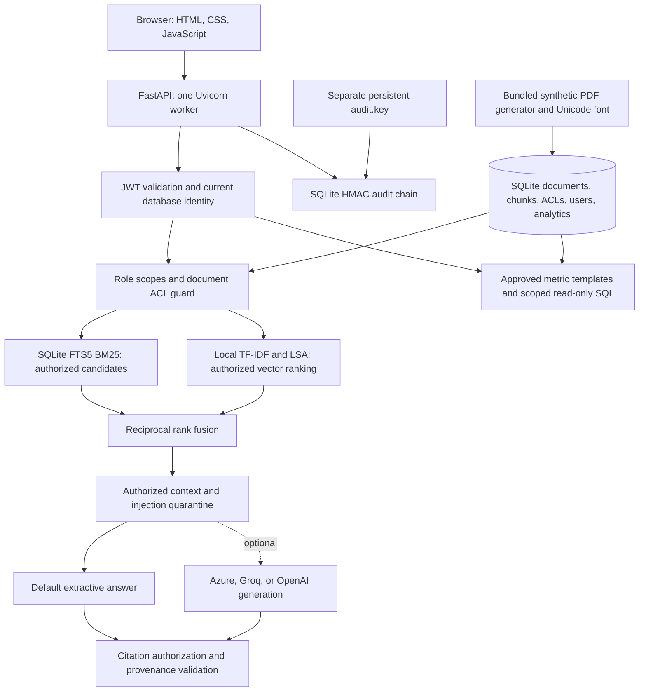

# OrgMind · RBAC Knowledge & Analytics Studio

A runnable, synthetic ACME Technologies demonstration of role-scoped document retrieval, cited answers, and constrained SQL analytics. FastAPI serves the API and a responsive, dependency-free browser interface at one URL. No external API keys are required.

> **PUBLIC DEMO WARNING:** `ALLOW_DEMO_PERSONA=true` lets **any visitor select any seeded persona, including administrator**. Administrators can inspect all documents, change roles/ACLs, upload/delete documents, and read audit logs. This is intentionally not private authentication. Use synthetic data only; never upload confidential information to the public demo. The supplied Render configuration explicitly enables this mode.

## Problem and scope

Enterprise search must not pass restricted documents to an answer generator just because they match a question. OrgMind enforces current database permissions before candidate ranking, context construction, citation inspection, and analytics. It demonstrates these controls rather than claiming production certification or mathematically leak-proof retrieval.

The five interface tabs are Knowledge Assistant, Live Role Comparator, SQL Studio, Document ACL & Audit, and Live Benchmark. Administrative tabs require backend authorization, not merely hidden UI controls.

## Architecture



**Stack:** Python **3.12.3** (tested development runtime and container base), FastAPI/Uvicorn, SQLite/FTS5, PyMuPDF, scikit-learn/NumPy, PyJWT, pwdlib/Argon2, HTTPX, pytest, and vanilla HTML/CSS/JavaScript. Dependency versions are maintained in `requirements.txt`. PyMuPDF 1.28.2 is intentionally pinned as the lightweight release, avoiding the ONNX/layout dependencies introduced by the removed 2.1 release.

### Project structure

```text
app/
  main.py                API, lifecycle, static frontend, authorization boundary
  config.py              Environment settings
  auth.py                Password login, demo personas, JWT validation
  manage.py              Local password provisioning
  database.py            Schema, idempotent seeds, ACL epoch, audit chain
  pdf_corpus.py          Nine reproducible synthetic PDFs
  assets/fonts/          DejaVuSans.ttf and LICENSE.dejavu.txt
  rag_engine.py          PDF extraction, chunks, BM25, LSA, RRF
  rbac_guard.py          Roles, scopes, citation authorization
  sql_analytics.py       Allowlisted, read-only analytics
  llm_service.py         Local generation and optional provider adapters
  http_limits.py         Multipart request-body limit
  evaluator.py           Fixed retrieval benchmark and memory sampling
static/                  index.html, styles.css, app.js
tests/                   Automated regression and boundary tests
data/corpus/             Generated synthetic PDFs (runtime)
data/runtime/            orgmind.sqlite3 and audit.key (runtime)
.env.example             Local configuration template
requirements.txt         Dependencies
Dockerfile               Single-process, non-root container
.dockerignore            Excludes local state and secrets from build context
render.yaml              Free, ephemeral-storage public-demo blueprint
```

## Local installation and startup

Use Python 3.12.3 with SQLite FTS5 support. From the repository root:

```bash
python3.12 -m venv .venv
.venv/bin/python -m pip install -r requirements.txt
cp .env.example .env
.venv/bin/python -m uvicorn app.main:app --reload
```

Open **http://127.0.0.1:8000**. Interactive API documentation is at `/docs`; readiness is `/api/health`. The development environment was installed and verified with Python 3.12.3. The explicit `.venv/bin/python` commands do not require activating the environment; alternatively run `source .venv/bin/activate`.

Startup initializes SQLite idempotently, generates/checks the nine synthetic PDFs, seeds documents once per database, indexes missing seeded chunks, and rebuilds the in-memory retrieval index. The bundled DejaVu font supports the `₹` glyph; **no system font installation is required**. Its redistribution notice is `app/assets/fonts/LICENSE.dejavu.txt`.

### Personas and authentication

| Persona ID / username | Role | Authorized scopes |
| --- | --- | --- |
| `admin_user` | `admin` | general, hr, finance, engineering, executive |
| `finance_user` | `finance` | general, finance |
| `hr_user` | `hr` | general, hr |
| `eng_user` | `engineering` | general, engineering |
| `general_user` | `employee` | general |
| `executive_user` | `executive` | general, executive |

Executive is **not** a superuser. A document is visible when any of its allowed scopes intersects the current role's scopes. The persona table describes initial roles; an administrator can change them.

The browser's persona selector calls `POST /api/auth/demo-persona` with `{"persona_id":"general_user"}` and receives a real signed token. It does not simulate authentication in the frontend. Seeded passwords are random Argon2 hashes: **there is no fixed demo password**.

For private mode, stop the server, set `ALLOW_DEMO_PERSONA=false`, set a stable random `JWT_SECRET` of at least 32 characters, and provision a password locally against the same `DATA_DIR`:

```bash
.venv/bin/python -m app.manage set-password admin_user
```

The command uses hidden interactive prompts, requires at least 12 characters, and invalidates prior tokens for that persona. Repeat for other required personas, then start the server and use password login. Private mode removes public persona access; it does not by itself provide all controls needed for a production service. Do not bake passwords or a provisioned database into the image.

JWTs use HS256, a 60-minute lifetime, issuer/audience checks, and required identity/version claims. Every protected operation reloads the user's role and `auth_version` from SQLite. Password or role changes invalidate old tokens. Development can use an ephemeral signing key, invalidating tokens at restart; production refuses a missing/short key.

## Retrieval, RBAC, and citations

1. Verify the bearer token and current database identity.
2. Resolve authorized chunk IDs from role scopes and document ACLs.
3. Apply authorization **before** BM25 ranking/limits and LSA vector similarity ranking.
4. Merge authorized candidates, quarantine suspicious context, and generate an answer.
5. Validate cited chunk authorization and document/page/title provenance; reauthorize citation inspection separately.

**BM25** uses SQLite FTS5 lexical matching. Query terms are OR-combined, so broad matches can include irrelevant but authorized evidence. **LSA** uses local TF-IDF unigram/bigram features with deterministic truncated SVD (up to 64 dimensions), normalized vectors, and cosine similarity; tiny indexes fall back to normalized TF-IDF. This is corpus-trained latent semantic retrieval, not a pretrained neural embedding model. **RRF** combines the two rankings with reciprocal scores $1/(60+r)$ for rank $r$, returning five chunks by default. Both rankings consider up to 30 candidates.

The local generator extracts up to three relevant sentences and returns inspectable citations. With no usable evidence, the denial text is:

> Insufficient authorized evidence in your permitted workspace scopes to answer this request.

Document upload, ACL edits, deletion, and user changes advance a global **ACL epoch**. Lifecycle writes rebuild the index; a stale epoch triggers rebuilding on retrieval. Ordinary requests do not repeatedly re-index unchanged data. There is **no answer cache**. A process-local lock serializes protected operations and lifecycle changes; this is why deployment uses exactly one worker, not multiple independent processes.

### Corpus

Nine synthetic PDFs cover the employee handbook, HR leave/compensation, finance budget, executive bonus/acquisition planning, engineering architecture, infrastructure runbook, procurement/vendor policy, general IT acceptable use, and a deliberately poisoned vendor brochure for injection tests. The handbook includes the **₹18/km** reimbursement example. Finance and executive personas can both see the bonus/acquisition document; HR, engineering, and employee personas cannot.

Admin uploads require `application/pdf`, a PDF signature, valid nonempty allowed scopes, and extractable text. Defaults limit PDF bytes to 5 MiB, pages to 100, and extracted text to 1,000,000 characters. Encrypted PDFs and image-only PDFs without extractable text are rejected; OCR is not provided. `app/http_limits.py` also caps the multipart request at the configured file-byte limit plus 65,536 bytes of overhead, including streamed bodies.

### SQL analytics

The API accepts a **metric ID**, never arbitrary SQL or model-generated SQL. Bound parameters supply the metric, optional period, and server-derived scope filter. A SQLite `mode=ro` connection, restrictive authorizer, 100,000 VM-step budget, and 50-row limit constrain execution. Results are checked against authorized scopes before return.

| Metric ID | Permitted roles |
| --- | --- |
| `department_headcount` | All roles; only their scoped rows |
| `quarterly_budget_summary` | admin, finance |
| `sla_uptime_metrics` | admin, engineering |
| `compensation_band_summary` | admin, hr |
| `vendor_spend_rollup` | admin, finance, hr; scoped rows |

Example request: `{"metric_id":"department_headcount","period":"2026-Q4"}` to `POST /api/sql/query`.

### Audit and prompt-injection limitations

Audit entries record identity, action, decision, policy rule/intercept, blocked document IDs where applicable, ACL epoch, and chained HMAC-SHA256 values. A separate persistent `data/runtime/audit.key` protects verification independently of JWT rotation. Preserve this key with the database and restrict filesystem access. The chain detects covered-entry edits without the key; it is **not externally anchored**, does not detect tail truncation, and cannot protect against an OS administrator or complete log-and-key compromise.

Suspicious instruction patterns in retrieved fields are quarantined before both generation paths. The question and authorized context are serialized as data in a separate user message; no tools are exposed to providers. Detection is a heuristic with false positives and false negatives, not a comprehensive injection defense. Authorization is enforced outside the model. Valid citations show authorized provenance, **not proof of every answer's factual correctness**. Shared corpus statistics, model hallucination, availability attacks, and broader side channels are not claimed eliminated.

## API reference

Protected routes require `Authorization: Bearer <token>`. Request models reject unexpected fields.

| Method and path | Access / request |
| --- | --- |
| `GET /api/health` | Public readiness and synthetic-data flag |
| `GET /api/config` | Public demo configuration and available personas |
| `POST /api/auth/login` | Public; `username`, `password` |
| `POST /api/auth/demo-persona` | Public only when enabled; `persona_id` |
| `GET /api/auth/me` | Authenticated current identity |
| `POST /api/chat` | Authenticated; `query` |
| `POST /api/chat/compare-roles` | Admin; `query`; evaluates five non-admin personas |
| `POST /api/sql/query` | Authenticated; `metric_id`, optional `period` |
| `GET /api/documents` | Authenticated, scoped document listing |
| `GET /api/documents/{doc_id}/chunks/{chunk_id}` | Authenticated, reauthorized evidence inspection |
| `POST /api/documents/upload` | Admin; multipart `file` and JSON-string `allowed_scopes` |
| `PATCH /api/documents/{doc_id}/permissions` | Admin; `allowed_scopes` array |
| `DELETE /api/documents/{doc_id}` | Admin |
| `PATCH /api/admin/users/{uid}/role` | Admin; `role` |
| `GET /api/admin/audit-logs?limit=50` | Admin; limit 1–100, chain-verification result |
| `GET /api/eval/benchmark` | Admin; evaluates current corpus without rewriting labels |

## Configuration and optional providers

Settings load `.env` for local development. Do not commit secrets; the Docker build excludes `.env`. Provider selection is opt-in, and provider use transmits questions and authorized context to the configured external service. Obtain appropriate permission before enabling it.

| Variable | Default / purpose |
| --- | --- |
| `APP_ENV` | `development`; `production` requires a strong configured JWT secret |
| `JWT_SECRET` | Ephemeral in development if absent/short; production requires ≥32 random characters |
| `ALLOW_DEMO_PERSONA` | `true` in development; `false` by default in production; Render explicitly overrides to `true` |
| `DATA_DIR` | `data`; writable database, audit-key, and corpus location |
| `MAX_UPLOAD_BYTES` | `5242880` |
| `CHUNK_SIZE`, `CHUNK_OVERLAP` | `900`, `150` characters |
| `GENERATION_PROVIDER` | `local`; alternatives `azure`, `groq`, `openai` |
| `GENERATION_TIMEOUT_SECONDS` | `15` |
| `AZURE_OPENAI_ENDPOINT`, `AZURE_OPENAI_API_KEY` | Required for Azure calls |
| `AZURE_OPENAI_DEPLOYMENT` | Azure generation deployment name |
| `AZURE_OPENAI_API_VERSION` | `2024-10-21` |
| `GROQ_API_KEY` | Required for Groq generation |
| `GROQ_BASE_URL`, `GROQ_MODEL` | `https://api.groq.com/openai/v1`, `llama-3.3-70b-versatile` |
| `OPENAI_API_KEY` | Required for OpenAI calls |
| `OPENAI_BASE_URL`, `OPENAI_MODEL` | `https://api.openai.com/v1`, `gpt-4o-mini` |
| `EMBEDDING_PROVIDER` | `local`; standalone adapter supports `azure` or `openai` |
| `AZURE_OPENAI_EMBEDDING_DEPLOYMENT` | Azure embedding deployment name |
| `OPENAI_EMBEDDING_MODEL` | `text-embedding-3-small` |
| `EMBEDDING_TIMEOUT_SECONDS` | `15` |
| `PORT` | Container listener port; defaults to `8000`, Render supplies it |

For Azure generation, set `GENERATION_PROVIDER=azure` and the endpoint, key, and generation deployment above. For Groq, set `GENERATION_PROVIDER=groq` and `GROQ_API_KEY`; model/base overrides are optional. For OpenAI, set `GENERATION_PROVIDER=openai` and `OPENAI_API_KEY`. Restart after changing generation selection. Missing configuration, transport errors, or invalid provider responses fall back to local extraction without exposing provider error bodies or secrets.

**Embedding scope:** `EmbeddingService` is a separately configured adapter and **extension point only, not wired into `RagEngine`**. Setting embedding variables does not replace or augment live retrieval: the application still uses offline LSA. Explicit adapter callers receive `None` for local mode and a sanitized error on external failure. `.env.example` documents the exact adapter names, including `AZURE_OPENAI_EMBEDDING_DEPLOYMENT` and `OPENAI_EMBEDDING_MODEL`, provider timeouts, and Groq defaults. External adapters have mocked tests; no real Azure/Groq/OpenAI calls or credentials were needed for local verification.

## Tests and measured results

```bash
.venv/bin/python -m pytest -v
```

**Final full-suite result:** `.venv/bin/python -m pytest -v` completed with **285 passed, 0 warnings in 48.75 seconds**. All 274 existing tests remain, with 11 added regression cases. Existing candidate-precision assertions are preserved under the accurately named `evidence_precision` metric. Starlette TestClient now uses pinned `httpx2`; provider integrations retain `httpx`. `tests/conftest.py` sets an explicit test-only JWT key before application imports, without changing deployment configuration or suppressing warnings. A regression test explicitly checks that a missing development key still emits its warning.

Test categories include corpus reproducibility and Unicode, identity/JWT invalidation, ACL filtering and lifecycle changes, citation provenance, constrained SQL, multipart limits, provider fallback, captured SpyLLM context, injection quarantine, fixed benchmark scoring, and frontend behavior. Local browser verification exercised real persona authentication, the ₹18/km answer and citation inspection, the role comparator's two successes/three denials for restricted shared evidence, all five tabs, request-race handling, and mobile layout. Final live-server checks passed for persona RAG, denials, SQL analytics, audit logging, and health.

### Gate 6 verification checklist

- [x] Full automated suite: 285 passed, no warnings.
- [x] Final live-server persona, retrieval/denial, SQL, audit, and health checks.
- [x] Fixed 21-case live retrieval benchmark and actual live-process RSS measurement.
- [x] Packaging source checks, Docker command syntax checks, and Render YAML parsing.
- [ ] Docker image build/run: CLI available, but daemon access denied.
- [ ] Real external-provider calls: require credentials; only mocked adapters tested.
- [ ] Render deployment: requires account authorization and manual deployment; not performed.

### Final live-server benchmark

Observed final live application results for the unchanged initial corpus and fixed **21 cases** in `app/evaluator.py` (16 positive cases and five restricted-topic probes):

| Method | Recall@5 | MRR | Answer citation accuracy | Evidence precision | Unauthorized retrieval rate |
| --- | ---: | ---: | ---: | ---: | ---: |
| BM25 | 1.000000 | 1.000000 | 0.937500 | 0.3333333333 | 0 |
| LSA | 1.000000 | 0.968750 | 0.937500 | 0.4750000000 | 0 |
| Hybrid RRF | 1.000000 | 0.968750 | 0.937500 | 0.3333333333 | 0 |

Recall is macro-averaged distinct relevant-document recall in the first five chunks; MRR uses the first relevant chunk rank. **Citation accuracy now evaluates actual answer citations per positive answered query**: at least one citation must identify an authorized returned chunk with exact database provenance and a ground-truth document/page curated as containing the expected evidence. Each answered query counts once; an answer without citations fails. Denials and empty answers are excluded from this denominator and reported as unanswered. This is page-level citation support, not full generated-answer factual accuracy or sentence-level entailment. The benchmark always uses deterministic local extractive generation, regardless of external-provider environment settings.

All three methods answered **16/16** positive queries, with correct citations for **15/16**. The remaining suspicious-email reporting query cited the employee handbook (DOC_01, page 2), not its expected evidence page (DOC_08, page 2), and correctly scored as a failure. No benchmark cases or relevance labels were changed.

The old `citation_accuracy` calculation divided **19 relevant candidate chunks by 57 returned positive-case chunks** for BM25/Hybrid (19/40 for LSA). That measures **evidence precision**, not whether an answer has a supporting citation. It remains available as `evidence_precision`, with its original assertions retained. Unrelated but authorized retrieval candidates can lower this precision even when Recall@5 is 1.0.

Restricted-topic probes contribute to unauthorized retrieval rate, not recall/MRR/citation accuracy. An unrelated authorized result is not counted as an unauthorized retrieval. Zero observed unauthorized retrieval is a result for this finite suite, not a universal guarantee. The benchmark expects original source pages and persona permissions and fails explicitly when those prerequisites are missing or changed; it does not restore deleted documents or rewrite ground truth.

**Memory:** the final live, single-worker Uvicorn process measured **177.03515625 MiB current RSS** on local Linux, sampled from `/proc/self/statm`. This is a local snapshot, not test-runner memory and **not a guarantee of fitting within 512 MB** under every workload. Startup, uploads, concurrency, provider calls, and dependency/platform differences can change usage. The live benchmark reports its own current memory observation.

## Docker

The image uses `python:3.12.3-slim-bookworm`, bundled fonts, an unprivileged user, and a single Uvicorn process serving both frontend and API. Run from the repository root:

```bash
docker build -t orgmind:local .
```

Before running, configure `.env` with a strong `JWT_SECRET` (at least 32 random characters). A local generator is:

```bash
.venv/bin/python -c 'import secrets; print(secrets.token_urlsafe(48))'
```

Store the generated value privately in `.env`; never commit it. To run the **synthetic public-persona demo**:

```bash
docker run --rm --name orgmind -p 8000:8000 --env-file .env \
  -e APP_ENV=production -e ALLOW_DEMO_PERSONA=true \
  -e DATA_DIR=/app/data orgmind:local
```

Open http://127.0.0.1:8000. Packaging source checks and Render YAML parsing passed locally; **image build/run remains unverified because access to the local Docker daemon was denied**. This command has ephemeral container storage. For optional local persistence, add `--mount type=volume,source=orgmind-data,target=/app/data` before the image name; preserve both SQLite and `audit.key`. For private mode, use `ALLOW_DEMO_PERSONA=false` and provision passwords with `python -m app.manage set-password admin_user` in a local container sharing that data volume, with the serving process stopped. Do not add extra Uvicorn workers.

## Render blueprint

`render.yaml` describes a **free Docker web service**, without a persistent disk. The Docker runtime pins the same tested Python 3.12.3 base; no separate native Python build is used. It binds to `0.0.0.0:$PORT`, uses `/api/health`, sets `APP_ENV=production`, generates `JWT_SECRET` through `generateValue: true`, and **explicitly sets `ALLOW_DEMO_PERSONA=true`** for the synthetic public demonstration.

1. Push the repository to a Git host accessible to your Render account.
2. Create a Render Blueprint from that repository and review the public-demo warning and generated environment settings.
3. Confirm creation manually, then check build logs, health, login, citations, and role boundaries at the assigned URL.

**Configuration generation is not deployment.** Render account authorization, an actual build/deploy, external-provider credentials, and cloud memory/availability validation remain manual; no live Render deployment is claimed.

Free-service local storage is ephemeral. Redeployment or instance replacement can lose uploads, ACL/role/password changes, and audit history. Startup seeds are idempotent within the existing database: **an ordinary restart does not resurrect an administrator-deleted document**. Only losing/replacing the database permits initial corpus seeding again. In-memory indexes are rebuilt as needed from stored chunks and the reproducible corpus. SQLite on this filesystem is not durable cloud persistence. Private cloud use needs a durable storage/provisioning design, not merely turning off the demo flag on a disposable instance.

## Limitations and future work

- Synthetic demonstration only; no production certification, API rate limiting, identity federation, or durable cloud storage is supplied.
- One process/worker is required by the synchronization model; scaling needs shared coordination and transactional cross-process authorization/index invalidation.
- Small-corpus LSA and lexical extraction have relevance limits; no OCR, neural embedding retrieval integration, or factuality proof is provided.
- Injection heuristics and unanchored local audit chains have the limitations described above.
- Public persona mode deliberately grants administrator access to everyone and permits destructive demo changes.
- Future work: managed durable database/object storage, externally anchored audit checkpoints, SSO and account lifecycle, rate/resource controls, isolated PDF processing, stronger evaluation on larger independently labeled corpora, and explicitly tested external embedding integration.
